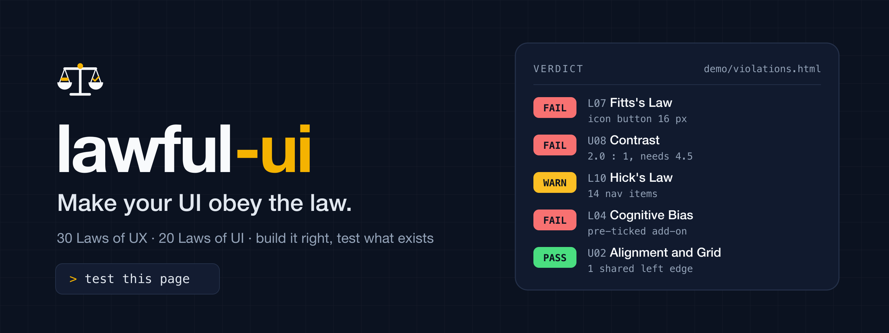

<p align="center">
  
</p>

<div align="center">

# lawful-ui

### Bikin UI-mu taat hukum.

Skill untuk AI agent yang menguji tampilan web dan mobile berdasarkan **30 Laws of UX** dan **20 Laws of UI**.

[Pasang](#cara-pasang) · [Daftar hukum](#daftar-hukum) · [Cara pakai](#cara-pakai) · [Coba demo](#coba-di-halaman-demo) · [English](README.md)

</div>

---

Cukup bilang ke AI agent "tolong testing halaman ini". Dengan lawful-ui terpasang, AI tidak lagi menebak, tetapi menjalankan prosedur:

1. Mendata semua layar dan semua komponen di dalamnya, termasuk state yang sering terlupa (kosong, loading, error, disabled).
2. Mengukur: ukuran target tap, rasio kontras, nilai jarak, jumlah pilihan per menu, isian form, waktu muat.
3. Menilai tiap komponen terhadap hukum yang berlaku dan memberi status: PASS, WARN, FAIL, N/A, atau NOT TESTED.
4. Menulis laporan: pelanggaran berurutan dari yang paling parah, masing-masing dengan bukti, dampak ke pengguna, dan satu perbaikan konkret.

Bisa dipakai pada aplikasi yang sedang berjalan (browser, emulator, simulator), pada kode sumber saja, atau pada screenshot. Setiap temuan menyebut asal buktinya.

## Contoh temuan

Dari pengujian halaman demo di repo ini:

```markdown
### F-01 Tombol paling menonjol "Daftar Sekarang" tidak melakukan apa pun: Critical

- Komponen: S1-C21 · Lokasi: form#signup > button.btn-b, demo/violations.html
- Law: L06 Doherty Threshold, L28 Von Restorff Effect, L10 Hick's Law, L17 Mental Model
- Bukti (measured): klik sungguhan menghasilkan 0 perubahan DOM dan tidak ada navigasi
  dalam 1 detik. Tombol ini yang terbesar di baris (162,7 × 42,5 px, tebal, biru), sedangkan
  tombol yang benar-benar mengirim form adalah "OK" (56,2 × 36 px, merah).
- Dampak: pengguna menekan tombol yang jelas-jelas "daftar", tidak terjadi apa-apa, lalu
  menekan lagi atau pergi. Tombol yang benar berwarna merah dan berlabel "OK", jadi terlihat
  seperti aksi berbahaya.
- Perbaikan: jadikan "Daftar Sekarang" satu-satunya tombol submit, tinggi minimal 44 px;
  hapus "OK" dan "Lanjut".
```

Laporan lengkap juga memuat inventaris komponen, hasil per komponen, tabel cakupan 50 hukum, skor UX dan skor UI, hasil per alur, catatan fungsional, urutan perbaikan, dan daftar yang tidak bisa diuji beserta alasannya. Contoh utuhnya ada di [`demo/sample-report.md`](demo/sample-report.md): 23 temuan pada halaman demo.

## Daftar hukum

### 30 Laws of UX (L01 sampai L30)

Seberapa cocok antarmuka dengan cara orang berpikir, memilih, mengingat, dan bergerak. Ditulis ulang sebagai kriteria uji dari [lawsofux.com](https://lawsofux.com/) karya Jon Yablonski.

| Kelompok | Hukum |
|---|---|
| Pilihan dan keputusan | Choice Overload, Hick's Law, Pareto Principle, Occam's Razor |
| Ingatan dan beban pikiran | Chunking, Cognitive Load, Miller's Law, Working Memory |
| Pengelompokan visual (Gestalt) | Common Region, Proximity, Prägnanz, Similarity, Uniform Connectedness |
| Perhatian dan penekanan | Selective Attention, Serial Position Effect, Von Restorff Effect, Aesthetic-Usability Effect |
| Menunjuk dan mengisi | Fitts's Law, Postel's Law |
| Waktu dan respons | Doherty Threshold, Parkinson's Law |
| Motivasi dan perjalanan | Flow, Goal-Gradient Effect, Peak-End Rule, Zeigarnik Effect |
| Ekspektasi | Jakob's Law, Mental Model, Paradox of the Active User |
| Kompleksitas dan etika | Tesler's Law, Cognitive Bias (dark pattern) |

### 20 Laws of UI (U01 sampai U20)

Seberapa baik antarmukanya dibangun. Tidak ada satu situs baku "Laws of UI", jadi kumpulan ini disusun dari [WCAG 2.2](https://www.w3.org/TR/WCAG22/), [Apple Human Interface Guidelines](https://developer.apple.com/design/human-interface-guidelines), [Material Design 3](https://m3.material.io/), dan praktik desain visual yang umum.

| Kelompok | Hukum |
|---|---|
| Layout | Visual Hierarchy, Alignment and Grid, Spacing System, Whitespace and Density |
| Tipografi dan warna | Typography, Readability, Color System, Contrast, Color Independence |
| Komponen | Consistency, Affordance, Touch Targets, Interactive States, Focus Visibility, Iconography, Form Layout |
| Permukaan dan media | Elevation and Layering, Imagery and Media, Motion |
| Adaptasi | Responsive and Adaptive Layout |

Angka yang berasal dari WCAG atau pedoman platform (target 24 px, 44 pt, 48 dp; kontras 4,5 : 1; respons 400 ms) diperlakukan tegas. Hitungan seperti "7 ± 2" hanya tanda untuk melihat lebih dekat, bukan vonis.

## Cara pasang

lawful-ui adalah agent skill standar: folder berisi `SKILL.md`. Pilih cara sesuai tool yang dipakai.

### Skills CLI

```bash
npx skills add SandroDuarsa/lawful-ui
```

### Plugin Claude Code

```text
/plugin marketplace add https://github.com/SandroDuarsa/lawful-ui
/plugin install lawful-ui@lawful-ui
```

### Claude.ai dan Claude Desktop

Unduh `lawful-ui.skill` dari [rilis terbaru](https://github.com/SandroDuarsa/lawful-ui/releases/latest), lalu unggah di Settings → Capabilities → Skills.

### Salin folder (agent apa pun yang membaca Agent Skills)

Clone repo ini dan salin `skills/lawful-ui` ke folder yang dibaca agent:

| Agent | Folder |
|---|---|
| Claude Code, semua proyek | `~/.claude/skills/lawful-ui/` |
| Claude Code, satu proyek | `<proyek>/.claude/skills/lawful-ui/` |
| Codex CLI | `~/.codex/skills/lawful-ui/` |
| Gemini CLI | `~/.gemini/skills/lawful-ui/` |
| Cursor | `<proyek>/.cursor/skills/lawful-ui/` |
| GitHub Copilot (VS Code) | `<proyek>/.github/skills/lawful-ui/` |
| Agent lain | biasanya `<proyek>/.agents/skills/lawful-ui/` |

```bash
git clone https://github.com/SandroDuarsa/lawful-ui
cp -R lawful-ui/skills/lawful-ui ~/.claude/skills/
```

Lokasi folder skill bisa berubah antar versi. Kalau skill tidak terdeteksi, cek dokumentasi agent yang dipakai.

### Plugin Codex dan Cursor

Manifest plugin untuk keduanya ada di repo ini (`.codex-plugin/`, `.cursor-plugin/`), mengikuti layout plugin masing-masing tool. Sejauh ini baru plugin Claude Code yang sudah divalidasi; kalau salah satunya tidak termuat, pakai cara salin folder.

```bash
codex plugin marketplace add SandroDuarsa/lawful-ui
codex plugin add lawful-ui@lawful-ui
```

```bash
agent plugin marketplace add https://github.com/SandroDuarsa/lawful-ui
```

### Agent yang belum mendukung skill

Salin `skills/lawful-ui` ke dalam proyek, lalu tambahkan teks ini ke file instruksi yang dibaca agent (`AGENTS.md`, `CLAUDE.md`, `GEMINI.md`, `.cursorrules`, dan sejenisnya). Teks yang sama ada di [`rules/lawful-ui.md`](rules/lawful-ui.md).

```text
Setiap kali diminta testing, QA, audit, atau review tampilan web / mobile,
baca dan ikuti skills/lawful-ui/SKILL.md sebelum mulai.
```

### Versi satu file

[`lawful-ui.md`](lawful-ui.md) adalah seluruh skill dalam satu file, untuk ditempel ke jendela chat. Script ukur tidak ikut di dalamnya.

```bash
curl -o lawful-ui.md https://raw.githubusercontent.com/SandroDuarsa/lawful-ui/main/lawful-ui.md
```

## Cara pakai

Minta dengan kata-kata sendiri. Skill ini dibuat untuk termuat saat ada permintaan testing, QA, audit, review, atau cek tampilan, dalam bahasa Indonesia maupun Inggris.

```text
Tolong testing halaman checkout di http://localhost:3000/checkout
Tes semua layar aplikasi Flutter ini
Cek UI/UX form pendaftaran ini                 (sambil melampirkan screenshot)
Review tampilan dashboard, lalu perbaiki temuan yang High ke atas
```

Hasil bawaannya adalah laporan. AI hanya mengubah kode kalau diminta memperbaiki, lalu mengukur ulang supaya laporan menunjukkan sebelum dan sesudah.

Di situs produksi yang sedang hidup, skill ini meminta AI hanya melakukan aksi yang tidak mengubah apa pun dan bertanya dulu sebelum mengirim form, karena testing berarti mengklik dan satu klik bisa membuat pesanan sungguhan.

## Cara mengukur

| Platform | Cara |
|---|---|
| Web | [`ux_probe.js`](skills/lawful-ui/scripts/ux_probe.js) dijalankan di halaman lewat otomasi browser apa pun (Playwright, Puppeteer, Selenium, browser milik agent, atau console). Script ini hanya membaca halaman. Yang dilaporkan: ukuran target, target yang berdempetan, kontras yang gagal, jumlah pilihan per navigasi dan select, gaya tombol, masalah field form, checkbox yang sudah tercentang, password yang terkirim lewat URL, skala jarak, tepi alignment, palet warna, radius, line-height, garis fokus yang dihapus, masalah gambar, zoom yang diblokir, dan waktu muat, masing-masing dengan selector supaya bisa ditemukan. |
| Web, interaktif | [`ux_checks.js`](skills/lawful-ui/scripts/ux_checks.js) menangani yang tidak bisa dibaca saja: apakah sebuah klik berefek (tombol mati), perhentian Tab mana yang kehilangan garis fokus, state mana yang punya gaya, serta tampilan sementara grayscale dan text-spacing. [`serve.py`](skills/lawful-ui/scripts/serve.py) menyajikan kedua script di localhost untuk browser agent yang hanya menerima string JavaScript. |
| Android | [`android_targets.py`](skills/lawful-ui/scripts/android_targets.py) membaca dump `uiautomator` dan melaporkan target tap di bawah 48 dp, target yang berdempetan, dan kontrol tanpa label. |
| iOS, Flutter, React Native | Panduan mengukur dari screenshot, accessibility tree, dan kode sumber. Belum ada script. |

Hal yang tidak terlihat oleh script (pengelompokan, pilihan kata, konvensi, alur, dark pattern, state) diperiksa langsung oleh AI mengikuti checklist.

## Coba di halaman demo

[`demo/violations.html`](demo/violations.html) adalah halaman pendaftaran yang sengaja melanggar banyak hukum: tombol ikon 16 px, navigasi 14 item, label hanya placeholder, tiga tombol utama yang bersaing, add-on berbayar yang sudah tercentang, urgensi palsu, zoom yang diblokir, dan lainnya.

```bash
cd demo && python3 -m http.server 8765
```

Lalu minta ke agent: `tolong testing http://127.0.0.1:8765/violations.html`.

## Batasan

- Ini audit heuristik. Ia menemukan masalah yang kemungkinan besar mengganggu, tetapi tidak menggantikan uji coba dengan pengguna sungguhan.
- Hukum UX adalah heuristik dari psikologi, bukan standar kepatuhan. Skill meminta AI menimbang konteks produk dan menyebut trade-off saat dua hukum saling bertentangan.
- Dua skor di laporan dipakai untuk membandingkan satu pengujian dengan pengujian berikutnya pada produk yang sama, bukan nilai rapor.
- Ukuran yang dibaca dari kode atau screenshot adalah perkiraan, dan laporan menandainya demikian.

## Isi repo

| Path | Isi |
|---|---|
| `skills/lawful-ui/SKILL.md` | Alur kerja dan aturan bukti |
| `skills/lawful-ui/references/laws.md` | 30 Laws of UX sebagai kriteria uji |
| `skills/lawful-ui/references/ui-laws.md` | 20 Laws of UI sebagai kriteria uji |
| `skills/lawful-ui/references/components.md` | Checklist per jenis komponen dan per alur |
| `skills/lawful-ui/references/web.md`, `mobile.md` | Cara mengukur di tiap platform |
| `skills/lawful-ui/scripts/` | Script-script ukur |
| `skills/lawful-ui/assets/report-template.md` | Template laporan |
| `rules/` | Pointer singkat untuk agent yang memuat rules, bukan skill |
| `lawful-ui.md` | Versi satu file, dibuat oleh `scripts/build-single-file.py` |
| `demo/` | Halaman demo, contoh laporan utuh, dan contoh dump Android |
| `assets/` | Logo dan banner (sumber SVG dan hasil render PNG) |

## Kredit

Laws of UX dikumpulkan oleh Jon Yablonski di [lawsofux.com](https://lawsofux.com/). Kriteria uji di sini ditulis dengan kata-kata proyek ini sendiri; tautan ke penjelasan asli ada di `laws.md`. Laws of UI bersumber dari WCAG 2.2, Apple Human Interface Guidelines, dan Material Design 3.

## Lisensi

[MIT](LICENSE)
