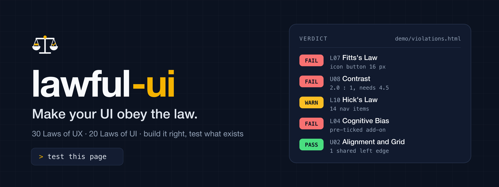

<p align="center">
  
</p>

<div align="center">

# lawful-ui

### Make your UI obey the law.

An agent skill that makes your AI **build** interfaces that follow **30 Laws of UX** and **20 Laws of UI**, and **test** existing ones against them.

[Two modes](#two-modes) · [Install](#install) · [The laws](#the-laws) · [Use](#use) · [Try the demo](#try-it-on-the-demo-page) · [Bahasa Indonesia](README.id.md)

</div>

---

## Two modes

| Mode | Starts when | What the agent does |
|---|---|---|
| **Build** | You ask it to create or change any UI: "build a sign-up page", "add a settings screen", "redo this form". You do not have to mention UX. | Builds to the laws from the start: one primary action, full-size touch targets, a spacing and type scale, contrast that passes, labelled fields, every state designed, a layout that works at 320 px. For a new screen it checks its own work and closes with a short **Lawful check** note. |
| **Test** | You ask it to test, QA, audit, or review a UI that exists. | Inventories every component, measures, checks each against the laws, and writes a findings report. |

Build mode sets constraints, not a style. Brand, palette, typeface, and layout stay yours; an existing design system wins wherever it meets the thresholds. Your explicit instruction always comes first, and if it breaks a firm threshold such as contrast, the agent says so once and then does what you decide.

The rules it builds with are in [`skills/lawful-ui/references/build.md`](skills/lawful-ui/references/build.md).

## Build mode, measured

[`demo/built.html`](demo/built.html) is a sign-up page an agent wrote with lawful-ui installed, from a one-line request that mentioned neither the skill nor UX. [`demo/violations.html`](demo/violations.html) is the same kind of page built badly on purpose. Both were measured with `ux_probe.js` and `ux_checks.js` at a 375 px phone width:

| Measure | `violations.html` | `built.html` |
|---|---|---|
| Touch targets under 44 px | 37 of 38 | 0 of 6 |
| Text contrast failures | 2 | 0 |
| Fields with label, type, or autocomplete problems | 14 of 15 | 0 of 4 |
| Spacing values off the 4 px scale | 63% | 0% |
| Tab stops with the focus outline removed | 36 of 38 | 0 of 6 |
| Sideways overflow | 757 px | 0 |
| Pre-ticked paid add-on | yes | no |
| Password sent in the URL | yes | no |
| Zoom blocked | yes | no |

One page from one run is an example, not a benchmark, and the agent that built it also had other UI skills installed.

## What Test mode does

Tell your AI agent "test this page". With lawful-ui installed, it stops guessing and runs a procedure:

1. Lists every screen and every component on it, including the states people forget (empty, loading, error, disabled).
2. Measures: tap-target sizes, contrast ratios, spacing values, choices per menu, form fields, load timing.
3. Checks each component against the laws that apply to it and gives each check a status: PASS, WARN, FAIL, N/A, or NOT TESTED.
4. Writes a report: violations ordered by severity, each with evidence, the cost to the user, and one concrete fix.

It works on a running app (browser, emulator, simulator), on source code alone, or on screenshots. Each finding says which of those it came from.

## What a finding looks like

From a run against the demo page in this repository:

```markdown
### F-01 The most prominent button, "Daftar Sekarang", does nothing: Critical

- Component: S1-C21 · Where: form#signup > button.btn-b, demo/violations.html
- Law: L06 Doherty Threshold, L28 Von Restorff Effect, L10 Hick's Law, L17 Mental Model
- Evidence (measured): a real click produced 0 DOM changes and no navigation within 1 second.
  It is the largest button in the row (162.7 × 42.5 px, bold, blue). The button that actually
  submits is "OK" (56.2 × 36 px, red).
- Impact: users press the button that plainly says "register", nothing happens, and they
  press again or leave. The working button is red and labelled "OK", so it reads as dangerous.
- Fix: make "Daftar Sekarang" the only submit button, at least 44 px tall; remove "OK" and "Lanjut".
```

The full report also has a component inventory, results per component, a coverage table for all 50 laws, a UX score and a UI score, flow results, functional notes, a fix order, and a list of what could not be tested and why. A complete one is in [`demo/sample-report.md`](demo/sample-report.md): 23 findings on the demo page, written in Indonesian because the request was.

## The laws

### 30 Laws of UX (L01 to L30)

How well the interface fits the way people think, decide, remember, and move. Restated as test criteria from [lawsofux.com](https://lawsofux.com/) by Jon Yablonski.

| Group | Laws |
|---|---|
| Choice and decision | Choice Overload, Hick's Law, Pareto Principle, Occam's Razor |
| Memory and mental effort | Chunking, Cognitive Load, Miller's Law, Working Memory |
| Visual grouping (Gestalt) | Common Region, Proximity, Prägnanz, Similarity, Uniform Connectedness |
| Attention and emphasis | Selective Attention, Serial Position Effect, Von Restorff Effect, Aesthetic-Usability Effect |
| Pointing and input | Fitts's Law, Postel's Law |
| Time and responsiveness | Doherty Threshold, Parkinson's Law |
| Motivation and journey | Flow, Goal-Gradient Effect, Peak-End Rule, Zeigarnik Effect |
| Expectations | Jakob's Law, Mental Model, Paradox of the Active User |
| Complexity and ethics | Tesler's Law, Cognitive Bias (dark patterns) |

### 20 Laws of UI (U01 to U20)

How well the interface itself is built. There is no single canonical "Laws of UI" site, so this set is drawn from [WCAG 2.2](https://www.w3.org/TR/WCAG22/), the [Apple Human Interface Guidelines](https://developer.apple.com/design/human-interface-guidelines), [Material Design 3](https://m3.material.io/), and common visual-design practice.

| Group | Laws |
|---|---|
| Layout | Visual Hierarchy, Alignment and Grid, Spacing System, Whitespace and Density |
| Type and color | Typography, Readability, Color System, Contrast, Color Independence |
| Components | Consistency, Affordance, Touch Targets, Interactive States, Focus Visibility, Iconography, Form Layout |
| Surface and media | Elevation and Layering, Imagery and Media, Motion |
| Adaptation | Responsive and Adaptive Layout |

Numbers that come from WCAG or a platform guideline (24 px and 44 pt and 48 dp targets, 4.5 : 1 contrast, 400 ms feedback) are treated as firm. Counts such as "7 ± 2" are treated as a prompt to look closer, not as a verdict.

## Install

lawful-ui is a standard agent skill: a folder with a `SKILL.md`. Pick the route for your agent.

### Skills CLI

```bash
npx skills add SandroDuarsa/lawful-ui
```

### Claude Code plugin

```text
/plugin marketplace add https://github.com/SandroDuarsa/lawful-ui
/plugin install lawful-ui@lawful-ui
```

### Claude.ai and Claude Desktop

Download `lawful-ui.skill` from the [latest release](https://github.com/SandroDuarsa/lawful-ui/releases/latest), then upload it under Settings → Capabilities → Skills.

### Copy the folder (any agent that reads Agent Skills)

Clone the repository and copy `skills/lawful-ui` into the folder your agent reads:

| Agent | Folder |
|---|---|
| Claude Code, all projects | `~/.claude/skills/lawful-ui/` |
| Claude Code, one project | `<project>/.claude/skills/lawful-ui/` |
| Codex CLI | `~/.codex/skills/lawful-ui/` |
| Gemini CLI | `~/.gemini/skills/lawful-ui/` |
| Cursor | `<project>/.cursor/skills/lawful-ui/` |
| GitHub Copilot (VS Code) | `<project>/.github/skills/lawful-ui/` |
| Other agents | usually `<project>/.agents/skills/lawful-ui/` |

```bash
git clone https://github.com/SandroDuarsa/lawful-ui
cp -R lawful-ui/skills/lawful-ui ~/.claude/skills/
```

Skill folders move between agent versions. If the skill is not picked up, check your agent's documentation for the current location.

### Codex and Cursor plugins

Plugin manifests for both are in this repository (`.codex-plugin/`, `.cursor-plugin/`), following each tool's plugin layout. Only the Claude Code plugin has been validated so far; if one of these does not load, copy the folder instead.

```bash
codex plugin marketplace add SandroDuarsa/lawful-ui
codex plugin add lawful-ui@lawful-ui
```

```bash
agent plugin marketplace add https://github.com/SandroDuarsa/lawful-ui
```

### Agents with no skill support

Copy `skills/lawful-ui` into your project and add this to the instruction file your agent reads (`AGENTS.md`, `CLAUDE.md`, `GEMINI.md`, `.cursorrules`, and similar). The same text is in [`rules/lawful-ui.md`](rules/lawful-ui.md).

```text
Whenever you create or change a user interface, read skills/lawful-ui/references/build.md
first and build to its rules. Whenever you are asked to test, QA, audit, or review an
interface, read skills/lawful-ui/references/test.md first and follow its workflow.
```

### The single file

[`lawful-ui.md`](lawful-ui.md) is the whole skill in one file, for pasting into a chat window. It leaves out the measuring scripts.

```bash
curl -o lawful-ui.md https://raw.githubusercontent.com/SandroDuarsa/lawful-ui/main/lawful-ui.md
```

## Use

Ask in your own words, in English or Indonesian. The skill is written to load on requests to build or change an interface, and on requests to test, QA, audit, review, or check one.

```text
Build a sign-up page for my store, one HTML file, primary color blue
Add a settings screen to this Flutter app
Test the checkout page at http://localhost:3000/checkout
Test every screen of this Flutter app
Check the UI/UX of this sign-up form          (with a screenshot attached)
Review the dashboard, then fix everything rated High or above
```

In Test mode the default deliverable is the report. The agent changes code only when you ask for fixes, and then re-measures so the report shows before and after.

Skills load when the agent judges them relevant. To make Build mode certain on every UI task, also add the pointer in [`rules/lawful-ui.md`](rules/lawful-ui.md) to your agent's always-on instruction file (`CLAUDE.md`, `AGENTS.md`, or the Cursor rule in `rules/lawful-ui.mdc`).

On a live production site the skill tells the agent to stay with actions that change nothing and to ask before submitting forms, because testing means clicking and a click can place an order.

## How it measures

| Platform | How |
|---|---|
| Web | [`ux_probe.js`](skills/lawful-ui/scripts/ux_probe.js) runs in the page through any browser automation (Playwright, Puppeteer, Selenium, an agent's browser tool, or the console). It only reads the page. It reports target sizes, crowding, contrast failures, choices per navigation and select, button styles, form-field problems, pre-ticked boxes, passwords sent in the URL, spacing scale, alignment edges, palette, radii, line height, removed focus outlines, image problems, blocked zoom, and load timing, each with a selector so it can be located. |
| Web, interactive | [`ux_checks.js`](skills/lawful-ui/scripts/ux_checks.js) covers what reading alone cannot: whether a click does anything (dead controls), which tab stops lose their focus outline, which state styles exist, and temporary grayscale and text-spacing views. [`serve.py`](skills/lawful-ui/scripts/serve.py) serves both scripts on localhost for browser tools that accept only a string of JavaScript. |
| Android | [`android_targets.py`](skills/lawful-ui/scripts/android_targets.py) reads a `uiautomator` dump and reports tap targets under 48 dp, crowded neighbours, and unlabeled controls. |
| iOS, Flutter, React Native | Guidance for measuring from screenshots, the accessibility tree, and source code. No script yet. |

Everything a script cannot see (grouping, wording, conventions, flows, dark patterns, states) is checked by the agent by hand, following the checklists.

## Try it on the demo page

[`demo/violations.html`](demo/violations.html) is a sign-up page that breaks many of the laws on purpose: 16 px icon buttons, a 14-item navigation, placeholder-only labels, three competing primary buttons, a pre-ticked paid add-on, fake urgency, blocked zoom, and more.

```bash
cd demo && python3 -m http.server 8765
```

Then ask your agent: `test http://127.0.0.1:8765/violations.html`.

## Limits

- This is a heuristic audit. It finds likely problems; it does not replace watching real users.
- The UX laws are heuristics from psychology, not a compliance standard. The skill asks the agent to weigh the product's context and to name the trade-off when two laws pull against each other.
- The two scores are for comparing one run with the next on the same product. They are not grades.
- Measurements from source code or screenshots are estimates, and the report labels them as such.

## Repository layout

| Path | What it is |
|---|---|
| `skills/lawful-ui/SKILL.md` | The two law sets and which mode to use |
| `skills/lawful-ui/references/build.md` | Build mode: the rules to build with and the check before delivering |
| `skills/lawful-ui/references/test.md` | Test mode: the workflow, rules of evidence, severity, and scoring |
| `skills/lawful-ui/references/laws.md` | The 30 Laws of UX as test criteria |
| `skills/lawful-ui/references/ui-laws.md` | The 20 Laws of UI as test criteria |
| `skills/lawful-ui/references/components.md` | Checklists per component type and per flow |
| `skills/lawful-ui/references/web.md`, `mobile.md` | How to measure on each platform |
| `skills/lawful-ui/scripts/` | The measuring scripts |
| `skills/lawful-ui/assets/report-template.md` | The report template |
| `rules/` | A short pointer for agents that load rules instead of skills |
| `lawful-ui.md` | The single-file version, built by `scripts/build-single-file.py` |
| `demo/` | The bad demo page, a page built in Build mode, a full sample report, and a sample Android dump |
| `assets/` | Logo and banner (SVG sources and PNG renders) |

## Credits

The Laws of UX were collected by Jon Yablonski at [lawsofux.com](https://lawsofux.com/). The test criteria here are this project's own wording; follow the links in `laws.md` for the original explanations. The Laws of UI draw on WCAG 2.2, the Apple Human Interface Guidelines, and Material Design 3.

## License

[MIT](LICENSE)
